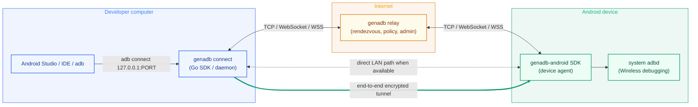
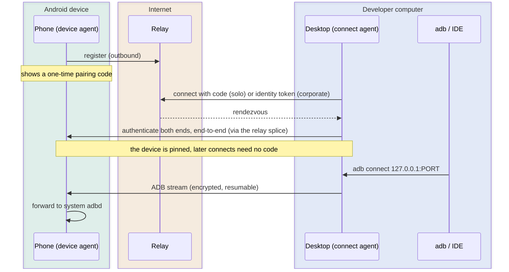
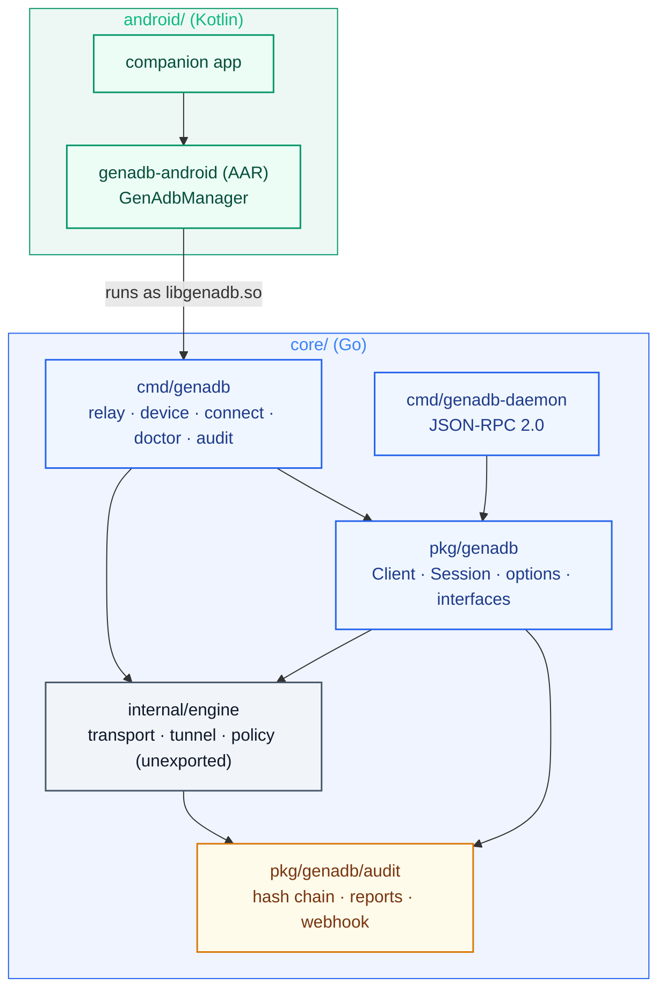

<p align="center">
  
</p>

<h1 align="center">New-GenADB</h1>

<p align="center">
  <a href="LICENSE"></a>
  <a href="API_SPEC.md"></a>
  <a href="android/genadb-android"></a>
  <a href="results.tsv"></a>
</p>

**Use a real Android phone from anywhere as if it were plugged into your computer.** New-GenADB connects Android Studio, any IDE, or plain `adb` to a physical device on another network: across the office, across the country, or behind a carrier NAT. You can deploy APKs and AABs, stream logcat, debug, push and pull files, and take screenshots.

```
$ genadb connect --relay wss://relay.example.com/ --code 4821-K7QZPM
{"event":"listening","addr":"127.0.0.1:41377","device_id":"pixel-7-…"}
$ adb connect 127.0.0.1:41377
$ adb install app-debug.apk      # Android Studio sees the device too
```

## The problem

`adb` assumes the device is within reach of a USB cable or the same Wi-Fi network. Real teams don't work that way:

- **Remote and hybrid developers** keep test phones at home, in the office or in a lab, and need to reach them from elsewhere.
- **QA and device labs** share a small pool of physical devices across many people and time zones.
- **Field and customer issues** happen on hardware, carriers and networks that an emulator can't reproduce.

The usual workarounds each fall short. `adb tcpip` exposed through a port forward is unauthenticated and unencrypted. A VPN gives everyone access to everything. Commercial device clouds are expensive and keep your builds on someone else's hardware. Screen-sharing tools can't install an APK from your IDE.

## Why it matters

New-GenADB makes a remote device look local to `adb`, and therefore to every tool built on it. It does this without asking you to trust the network in between:

- **End-to-end encrypted and mutually authenticated.** The relay that connects the two sides only forwards opaque bytes. It never sees ADB traffic, files, or the pairing code.
- **Zero-config for individuals.** Install the companion app, read a one-time code off the phone, and connect. Pairing is remembered.
- **Governed for organisations.** In corporate mode, identity tokens, per-device grants, revocation, device-management restrictions and a tamper-evident audit trail decide who may debug which device.
- **Built for bad networks.** Sessions survive Wi-Fi to cellular handovers and short outages without `adb` noticing. When both sides share a network, traffic takes a direct LAN path automatically.
- **Embeddable.** A Go SDK, a local JSON-RPC daemon and an Android library (AAR) let you build it into IDE plugins, device-lab tooling and your own apps.

## Architecture



Each side connects outbound to the relay, so neither the phone nor the computer needs an open port. The relay matches the two sides and splices their connections. The two agents then establish their own encrypted, authenticated session through that splice. In solo mode the relay forwards only and learns nothing about what you do.





The wire protocol, framing and session security live in `internal/engine` and are deliberately not part of any public API.

### Modes

| | Solo | Corporate |
|---|---|---|
| Trust | One-time pairing code, then the device is pinned | Identity token per user, enrollment token per device, organisation policy |
| Who may connect | Whoever paired | Users granted the device by policy; revocation takes effect immediately |
| Device management | n/a | Respects `DISALLOW_DEBUGGING_FEATURES`; relay URL and enrollment come from EMM managed configuration |
| Audit | Off by default (opt in) | Always on: relay and desktop write hash-chained logs, with an optional signed webhook |
| Direct LAN path | Yes | Relay only |

## Quickstart: CLI

```bash
cd core && go build -o genadb ./cmd/genadb

# 1. A relay somewhere both sides can reach (a small VM, or a tunnel to your laptop)
./genadb relay --listen 0.0.0.0:7000 --ws-listen 0.0.0.0:8443 --tls-cert cert.pem --tls-key key.pem

# 2. On the phone: the companion app (android/) or the agent itself
./genadb device --relay wss://relay.example.com:8443/ --adbd auto
#   -> {"event":"pairing_code","code":"4821-K7QZPM",...}

# 3. On your computer
./genadb connect --relay wss://relay.example.com:8443/ --code 4821-K7QZPM
adb connect 127.0.0.1:<port from the "listening" event>

# Later: no code needed
./genadb connect --relay wss://relay.example.com:8443/ --device <device id>

# Something wrong? Check adb, state, proxy settings and relay reachability
./genadb doctor --relay wss://relay.example.com:8443/
```

## Quickstart: Go SDK

```go
import (
    "context"
    "errors"
    "fmt"
    "os"

    "github.com/sumukhak/new-genadb/core/pkg/genadb"
    "github.com/sumukhak/new-genadb/core/pkg/genadb/audit"
)

func main() {
    ctx := context.Background()
    c, err := genadb.New(
        genadb.WithRelayURL("wss://relay.example.com:8443/"),
        genadb.WithStateDir("~/.genadb"),
        genadb.WithReconnectPolicy(genadb.DefaultReconnectPolicy),
        genadb.WithEventHandler(func(e genadb.Event) { fmt.Println(e.Type, e.Fields) }),
    )
    if err != nil {
        panic(err)
    }
    defer c.Close()

    sess, err := c.Connect(ctx, genadb.ConnectRequest{PairingCode: "4821-K7QZPM"})
    switch {
    case errors.Is(err, genadb.ErrBadCode):
        // ask the user to re-enter the code
    case err != nil:
        panic(err)
    }
    fmt.Println("adb connect", sess.ADBAddr())

    // Corporate deployments: genadb.WithCorporateToken(token, policyPath) turns on
    // policy checks and a hash-chained audit log. Export it at any time:
    c.ExportAuditReport(os.Stdout, audit.FormatHTML, audit.Options{})
}
```

Other languages can use `genadb-daemon`, which offers the same operations over JSON-RPC 2.0 on loopback. See [API_SPEC.md](API_SPEC.md).

## Quickstart: Android (Kotlin)

```kotlin
// settings.gradle.kts: include(":genadb-android"), or depend on genadb-android.aar
// app/build.gradle.kts: packaging { jniLibs { useLegacyPackaging = true } }

val genadb = GenAdbManager.initialize(
    GenAdbManager.Builder(context)
        .config(GenAdbConfig(relayUrl = "wss://relay.example.com:8443/"))
)

genadb.start()                       // call from a foreground service
lifecycleScope.launch {
    genadb.connectionState.collect { state ->
        when (state) {
            is ConnectionState.Online -> showCode(state.pairingCode)
            is ConnectionState.Blocked -> showPolicyMessage(state.reason)
            is ConnectionState.Reconnecting -> showRetry(state.attempt)
            else -> Unit
        }
    }
}
val code = genadb.pair()             // suspend; solo mode
genadb.stop()
```

In corporate mode, the relay URL, enrollment token and policy come from EMM managed configuration. Device-side audit records then appear on `genadb.auditEvents`.

Build the library with `./gradlew :genadb-android:assembleRelease`, which writes `genadb-android/build/outputs/aar/genadb-android.aar`. The build cross-compiles the Go core, so Go 1.24+ must be on `PATH`.

## Audit and reports

In corporate mode every session and ADB operation is recorded. Each record names:

- the user (token subject and token ID) and the device
- the transport: LAN, or relay over TCP, WS or WSS
- the operation: shell (command name only), push, pull, install, forward, reverse, debug or screencap
- bytes in each direction and the duration
- the SHA-256 of pushed and pulled files

Records never contain passwords, tokens, pairing codes, command arguments or file contents. The log is append-only JSONL, and each record carries the hash of the previous one, so editing, deleting or reordering any record is detectable.

```bash
genadb audit verify --log audit.jsonl
genadb audit report --log audit.jsonl --format html --since 168h --out weekly.html
genadb audit report --log audit.jsonl --format csv   # one row per record, spreadsheet-safe
```

Records can also be forwarded to a SIEM or collector as they happen (`--audit-webhook-url`), with each delivery signed with HMAC-SHA256.

Operation-level records need the ADB stream to be visible to the desktop agent, which is the case with classic `adb tcpip`. When adbd upgrades the connection to TLS (Android 11+ Wireless debugging pairing), the stream is opaque, and sessions are recorded with byte counts and duration only.

## Benchmarks

These figures come from the locked evaluation harness (`eval.py`, a simulated WAN with a fake adbd) and from hardware runs on a Pixel 7 and a POCO F1.

| Metric | Result |
|---|---|
| Overall eval score | 98.97 / 100 |
| Time from `connect` to `adb`-ready | 0.9 s |
| Push throughput through the relay (simulated WAN) | 11 MB/s, up from 5.7 MB/s before ADB-aware flow control |
| Logcat line latency (median) | 44 ms, down from 86 ms |
| JDWP round trip, direct LAN path vs relay | 3 ms vs about 250 ms |
| Recovery after a network outage, `adb` session kept | about 4 s (simulated); 2.9 s after a 40 s radio loss on a Pixel 7 |
| Corporate revocation, live session killed | under 0.1 s |
| 10 MiB push over Wi-Fi, tunnel vs direct `adb` (Pixel 7) | 669 ms vs 587 ms |
| Tampered or replayed traffic | always detected; never delivered silently |

## Repository layout

| Path | What |
|---|---|
| `core/cmd/genadb` | CLI: `relay`, `device`, `connect`, `keygen`, `doctor`, `audit`, `version` |
| `core/cmd/genadb-daemon` | JSON-RPC 2.0 daemon for IDE plugins and UIs |
| `core/pkg/genadb` | Public Go SDK |
| `core/pkg/genadb/audit` | Hash-chained audit log, reports, webhook sink |
| `core/internal/…` | Engine: transport, tunnel, policy (not public API) |
| `android/genadb-android` | Android SDK (AAR) |
| `android/agent-protocol` | Platform-neutral Kotlin half of the SDK, JVM-tested |
| `android/app` | Companion app built on the SDK |
| `eval.py`, `harness/` | Locked evaluation harness |
| `docs/research/` | Research findings, notes and reports behind the design (locked record) |

## Building and testing

```bash
cd core && go vet ./... && go test ./...      # Go SDK, engine, daemon, audit
python3 eval.py                               # end-to-end evaluation (builds via solution.py)
cd android && ./gradlew :agent-protocol:test  # Kotlin SDK logic, no Android SDK needed
cd android && ./gradlew :genadb-android:assembleRelease :app:assembleDebug
```

## Security

If you believe you have found a security issue, please do not open a public issue. Report it privately through GitHub's "Report a vulnerability" (security advisories) on this repository.

## License

Apache License 2.0. See [LICENSE](LICENSE) and [NOTICE](NOTICE). Contributions are welcome: see [CONTRIBUTING.md](CONTRIBUTING.md).
